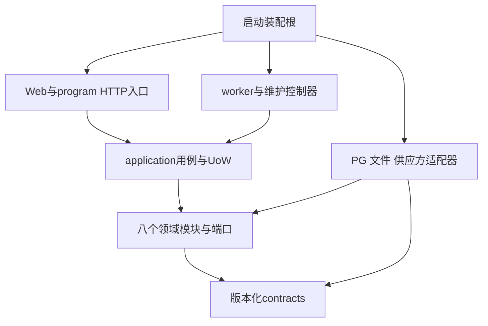

# RAG_all 架构主干

本主干固定不同功能开发者必须共享的技术边界；业务含义以[现行PRD](/E:/aaa-project/rag/_bmad-output/planning-artifacts/prds/prd-RAG_all-2026-10-15/prd.md)、[实施契约](/E:/aaa-project/rag/_bmad-output/planning-artifacts/prds/prd-RAG_all-2026-10-15/ir-review-2026-10-15/implementation-contract.md)和[实施切片](/E:/aaa-project/rag/_bmad-output/planning-artifacts/prds/prd-RAG_all-2026-10-15/ir-review-2026-10-15/implementation-slices.md)为真源，架构不覆盖它们。视觉与交互分别继承[DESIGN](/E:/aaa-project/rag/_bmad-output/planning-artifacts/ux-designs/ux-RAG_all-2026-10-16/DESIGN.md)和[EXPERIENCE](/E:/aaa-project/rag/_bmad-output/planning-artifacts/ux-designs/ux-RAG_all-2026-10-16/EXPERIENCE.md)。当前无应用代码；本文不是实现或运行通过记录。

## Design Paradigm

模块化单体与端口适配器：一个后端代码库、同一数据库、API与worker两个业务进程；application用例协调领域模块，框架、PG和外部供应方只出现在入口或适配器。八个代码模块的写状态所有权如下。

| 模块 | 唯一写状态 | 其他模块使用方式 |
| --- | --- | --- |
| identity_access | 账号、空间、成员/邀请/角色/授权/负责人、Web会话、程序凭证 | 当前授权端口与去秘密DTO |
| library | 文档、不可变版本/归一来源定位、active_version/current_candidate、文档墓碑 | 授权后资料投影、来源读取端口 |
| indexing | embedding profile、generation、docset_revision、KB guard、结构块/向量及可见性 | 固定快照的检索/发布端口 |
| execution | 上传意图、job/attempt/lease、核对上下文、物理槽、账号/用途共享rate pool与call permit、writer/prefix/asset清单与cleaned | 有界执行、原子调用gate及停写证明端口 |
| query | retrieval上下文、问答/比较operation、输入/执行/预算快照、结果与EvidenceSnapshot、反馈 | 受控状态/结果/引用投影 |
| ledger | 原件容量与预留、空间日桶与产品计次、逐call意图/成本事实及transition | 同UoW的条件记账端口 |
| conversation | 单空间会话、父轮次、未终结轮次指针、消息到结果/证据ID的引用 | 有限历史与条件追加端口 |
| platform_ops | 配置版本、恢复隔离/放行清单、安全台账/导出清单、独立epoch对照 | 元数据控制与安全事件追加端口 |



## Invariants & Rules

### AD-1 — 共享用例与向内依赖 [ADOPTED]

- **Binds:** all。
- **Prevents:** Web、program、worker各自复制业务与授权，领域反向依赖框架。
- **Rule:** 所有入口调用同一application用例；领域只依赖自身模型、contracts及声明端口，不导入FastAPI/SQLAlchemy/HTTP SDK；基础设施实现端口，装配根注入。模块之间不互调HTTP、不各设数据库或队列。首版保持显式RAG步骤与PG任务，不引入Redis/Celery/LangChain/LangGraph。

### AD-2 — 每份状态只有一个写者

- **Binds:** 八模块全部持久状态。
- **Prevents:** 两个模块都切active_version、写来源、追加历史或释放配额。
- **Rule:** 上表是写入能力边界；只有所属模块仓储能变更其表/字段。application可以在同一UoW调用多个模块端口，不能旁路写其他模块表。跨模块读取使用受控投影；Query不拥有资料或授权真源，conversation不复制来源，ledger不证明文件停写。Library登记规范SourceLocator，Query登记本轮实见EvidenceSnapshot；execution写cleaned，ledger写对应唯一账转换。

### AD-3 — 用例事务与全局锁序 [ADOPTED]

- **Binds:** 所有状态变更、API/worker/扫描器。
- **Prevents:** 半发布/半计次、space与KB反向锁死、长外部等待占连接。
- **Rule:** 同步SQLAlchemy短Session每线程独立；application统一begin/commit/rollback，仓储不commit、不跨线程传Session。所有当前授权关键事务固定锁序：全部所需账号控制行ID升序→空间控制行ID升序→KB ID升序→业务类别(document/candidate/job/operation/conversation)及ID升序→空间容量/日桶→文档本地gate ID升序→provider rate pool ID升序→call ID升序→permit组件ID升序→asset ID升序；不需的类别跳过。鉴权取SH、安全变更取EX并覆盖相应子表写入，提前确定锁集合，后序不可回取/无序升级。后台已受理库任务从space SH起且永不回取用户；迟到成本仅call不取父锁。PG事务内不等待OS锁、网络、进程退出或大文件删除；OS锁取得后才开短事务复核。锁覆盖范围、重核与同UoW矩阵见[共享契约](/E:/aaa-project/rag/_bmad-output/planning-artifacts/architecture/architecture-RAG_all-2026-10-16/shared-contracts.md)。

### AD-4 — 当前身份、显式范围与统一授权 [ADOPTED]

- **Binds:** FR-1–FR-5、SM-6、全部私有读写与外传。
- **Prevents:** 平台越权、双凭据回退、静默缩目标、撤权后缓存泄漏。
- **Rule:** Web只认服务端Cookie会话，program只认本人只读Bearer；同请求带二者整拒。角色/负责人/逐库范围与scope按当前服务端事实取交集，显式目标逐项校验、任一不可用整拒。派发、完整放行、历史、重放、citation及每次资源读取都重核；AuthContext仅身份载体，不是永久许可。上传受理前按当前维护权；已受理库任务按库资格继续，程序仅本人状态读。密码/会话/凭证/供应方秘密的有限技术规则同源于共享契约。

### AD-5 — 单一共享schema与来源表示

- **Binds:** API、worker、RAG、前端与所有适配器。
- **Prevents:** 手写枚举、坐标、offset、限制与compact128规则分叉。
- **Rule:** 后端contracts拥有严格请求/响应、公共envelope/error、EffectiveLimits、ExecutionFence、SourceLocator、EvidenceSnapshot和独立状态投影；同一schema导出OpenAPI/JSON Schema、TS类型与正负样例。前端不得自造状态或裁文本使其合法。模型generation子契约与公共业务DTO分离，generation_contract_id贯穿配置、提示、校验和快照；catalog/可信metadata只由服务器产生。坐标/哈希/Unicode偏移按共享契约，不由parser或UI自选。

### AD-6 — 上传、版本与墓碑 [ADOPTED]

- **Binds:** FR-6–FR-8、FR-15；library、execution、indexing、ledger。
- **Prevents:** 重传新建候选、失败替换破坏旧版、删除后迟到发布、状态终结即释放字节。
- **Rule:** 每文件upload_operation_id绑定规范参数、候选、有限期限与唯一预留；重复带体PUT在有界验证槽中核实际hash/长度，同内容才重放。原件不可变，校验登记、预留转实占与job创建同UoW；FS/PG之间以唯一prefix、资产清单及恢复扫描协调。完整替换候选与全部合格索引同事务切active_version；仅首次导入可发布有可靠范围说明的partial，替换partial不覆盖旧版。删除先墓碑和检索不可见，迟到attempt不能复活；cleaned独立于业务状态，留存原件和cleanup_blocked继续占用。校核修正建新候选，不原地改已发布来源。

### AD-7 — 单次外传与可停止的执行者 [ADOPTED]

- **Binds:** 所有供应方请求、上传、文件写入、worker及维护恢复。
- **Prevents:** 旧attempt继续派发、SDK暗重试、超时线程仍写文件、仅凭PID消失释放空间。
- **Rule:** API/worker控制器持业务资格，每个物理槽监督有绝对期限且可等待停止的子执行者；child不写业务DB、不持主密钥、不自主串阶段，单call最少秘密只经私有有界IPC注入。每次传输含上游返回签名URL先过统一EgressTarget校验，持久prepared，再临近发送复核并条件转may_have_sent，提交后给一次grant；该call永不重发，显式重试新call且重过守卫，自动重试/重定向关闭。may_have_sent与网络非原子，撤销后可能仍收费，迟到事实只补账。调用按真实适用的HTTP/异步task等限制维度领取许可；原task只读轮询不重复新增task占用，HTTP响应不证明异步task终态。物理槽仅确认本槽全部写入者/后代已停才复用；writer持稳定生命周期OS锁，cleanup先fence、事务外停写及取EX锁、删除核验，再同UoW标cleaned和释放账；不能证明就blocked。详见[运行契约](/E:/aaa-project/rag/_bmad-output/planning-artifacts/architecture/architecture-RAG_all-2026-10-16/runtime-operations.md)。

### AD-8 — 三账与唯一结算 [ADOPTED]

- **Binds:** 原件容量、产品问答次数、实际外部调用及成本。
- **Prevents:** 失败抹成本、空间重复归还、跨日重复扣次、将未知填零。
- **Rule:** ledger独占三账。原件容量=全部保留版本原件+在途预留，条件受理且更新先完整预留；不含解析/图片/向量/临时/备份的物理量另受预算和低水位约束。产品按空间+上海受理日预留，一个逻辑操作只有一个终态效果；正常完整答复含确定性零候选不足结算1，纯检索不扣，业务失败释放。逐call保留意图、实际发送不确定性、usage/币种/费用依据，NULL+unknown不变0。cleaned proof与唯一quota_transition同UoW；迟到成本按call幂等追加，冲突保留双方来源待核，不改业务、历史或产品次数。

### AD-9 — 不可变向量空间与索引代次 [ADOPTED]

- **Binds:** S2导入、B0检索、S6重建、历史回看与GC。
- **Prevents:** 混用维度/模型空间、重建覆盖变化集、旧guard解新锁、清索引破坏证据。
- **Rule:** embedding profile不可变；模型/部署、用途、维度D、预处理和计数依据进入compatibility fingerprint。D由P0实测后显式迁移vector(D)，不在请求内DDL；不兼容profile整体拒绝。每库active_generation、docset_revision与绑定job/attempt的guard；普通同profile增量发布，重建取快照后旧代可读、拒新导入/修正，允许删除且revision改变使旧快照不能切换；仅持有者可条件释放本guard。切代与文档可见性同UoW；查询固定代次与版本，EvidenceSnapshot独立持久保存，GC不得破坏合法历史证据与来源引用。

### AD-10 — 显式RAG、实际预算与实见证据 [ADOPTED]

- **Binds:** 四场景、retrieval/answer/comparison、SM-1–SM-5。
- **Prevents:** 偷扩K、当前输入暗裁、目录冒充实见证据、预算失败伪装不足、模型截断假成功。
- **Rule:** B0在PG内先按当前授权/父级/墓碑/固定版本过滤，再精确cosine排序；比较按条件原序+文档ID升序展开，固定名次轮转合并，全请求去重后最多K=5。H协议硬界/B新操作业务上限/M真实用途profile取交集，当前question/日志保留原解码输入；每次完整消息计I并预留最大合法完整输出R，未证profile不得发生成。先剔除整条有限辅助历史，再从第5至第1缩减连续来源原子组，保持表头/单位/型号/适用条件；catalog精确等于实见片段。全部子检索成功且原始最终候选0才服务器完整不足模板；原有候选因预算全裁空、非零但生成未证/超限、依赖失败各为失败。普通answer-compact128和comparison-compact128按独立子契约严格验；length/无完整终止即使JSON可解析也失败。只允许无语义去围栏/空白，不加LLM改写/修复，不改变原金标/K/SM。

### AD-11 — 逻辑终态、并发与会话 [ADOPTED]

- **Binds:** 问答、比较、纯检索、历史与网络恢复。
- **Prevents:** 成功丢回包重复付费、失败同Key重跑、跨日重复扣次、多轮乱序和物理槽早复用。
- **Rule:** request_id标HTTP尝试，operation_id标持久逻辑操作，Idempotency-Key在用户+空间+能力唯一，按原规范版本完整输入HMAC匹配；先处理已有Key，后对新Key施当前B/M。接受固定原受理日、epoch、模型/预算/索引/文档快照及deadline；结果+依赖+一对会话消息+次数终态同UoW且token/attempt/lease条件成立。成功同Key当前授权后重放原结果，失败回原失败，过期410，异输入409，恢复epoch拒旧；不会自动新Key。全部查询共PG逻辑gate初值全局2/每用户1/子路1且无查询等待队列；纯检索也有持久执行上下文和call账。execution另以PG账号总池+用途子池按实际限制维度原子发call permit组件，API/worker/所有凭据共池，不各自计额；每组件唯一领取/按本维终态证据一次释放，原task核对不新占task，逻辑gate、rate permit与真实物理槽独立。会话单空间，一个未终结轮次，父轮次条件追加；最多两条合法用户历史整条纳入/剔除，不把旧答案/证据当新证据。

### AD-12 — UX投影与私有响应归属 [ADOPTED]

- **Binds:** IA-1–IA-12、所有Web私有异步页面及来源回看。
- **Prevents:** job状态吞旧版、清理状态伪装可用性、迟到回包跨账号/空间、前端裁128掩盖非法输出。
- **Rule:** 分离active_version、candidate、job、index_generation、cleanup五个投影，返回有限allowed_actions与EffectiveLimits；服务端执行时仍重核。请求/轮询/回调持账号+登录实例+空间+epoch+本地代次及适用操作/父轮次归属，切换或退出清私有状态，回包入视图/缓存前复核；Abort不能替代归属校验。非流式完整答案一次展示，202/断网只查原操作/同Key，失败须用户新逻辑操作。PDF可信页/bbox高亮、非PDF真实结构、无bbox回退页，定位损坏明示不猜；模型Markdown清洗，URL/下载由受控后端解析。视觉、键盘、窄屏和错误呈现继承UX包，不另造设计体系。

### AD-13 — 四服务部署与可信恢复 [ADOPTED]

- **Binds:** NFR-3–NFR-6、恢复、安全台账和平台运维。
- **Prevents:** 备份回滚复活权限/凭证、业务依赖开发电脑、运维日志泄漏正文、半备份假可恢复。
- **Rule:** 同一Ubuntu主机Compose gateway/API/worker/PG四服务，仅gateway对外；API与worker同代码/模型，PG任务，不增常驻队列。独立持久epoch控制、break-glass和受托安全台账介质不随DB回滚；epoch缺失/矛盾默认隔离。恢复先停流量和全部写入者、一致恢复DB与资产，再生成新随机epoch并使旧会话/凭证/执行失效；账号、权限、墓碑、配额与不完任务逐范围核对后放行，不能用旧DB自证。平台仅受控元数据；结构日志、审计、安全台账和逐call事实分开。秘密按服务最少挂载，备份包含匹配资产/配置/密钥恢复材料，频率/留存/丢失窗在S6登记并实演。

### AD-14 — 切片依赖与可验证门槛 [ADOPTED]

- **Binds:** S0–S7、P0、F0及全计划实施判断。
- **Prevents:** S0可开工冒称全期能力通过、调优后挑题、官方版本冒充组合已安装。
- **Rule:** S0可独立开始；其调用/资产/epoch骨架可用且具真实凭证后尽早P0、可并行S1。S2解析/来源/embedding、S3完整预算、S5真正图意分别按真实前置停行；S6验证目标4C4GB、证书、介质/操作者与恢复；F0在首次调优前冻结32题/版本/hash/原金标，开发题隔离，S7按原SM全门槛。本轮用户授权将旧整文档并发1改为两项全系统独立上限：活跃文档job≤4、未证终态远端task≤4（各默认4、可配置1–4）；本机重处理物理槽仍1，真实生效受账号共额及资源验证限制，远端等待不持正文缓冲/Session/常驻child。Stack仅官方核实冷启动seed，S0须锁依赖/镜像digest并验证组合；上游模型/图意/计数/D/额度未知保持显式未证，不编成绩，不以假件代真实。实现路径与门槛映射见[需求追溯](/E:/aaa-project/rag/_bmad-output/planning-artifacts/architecture/architecture-RAG_all-2026-10-16/requirements-architecture-traceability.md)。

## Stack & Versions

以下是2026-10-16已核官方页面的冷启动seed，非永久不变量；S0锁文件与工件接管具体依赖。选择与真实适用性分别记录在[技术证据](/E:/aaa-project/rag/_bmad-output/planning-artifacts/architecture/architecture-RAG_all-2026-10-16/technology-evidence.md)，不可只改本表而不重核组合。

| Name | Version | 用途 |
| --- | --- | --- |
| Python | 3.12.15 | API/worker同运行时，3.12维护线 |
| FastAPI / Pydantic | 0.143.2 / 2.14.1 | HTTP/OpenAPI与严格contracts |
| SQLAlchemy / psycopg / Alembic | 2.0.54 / 3.3.6 / 1.20.0 | 同步UoW/PG驱动/显式迁移 |
| PostgreSQL / pgvector | 18.6 / 0.8.7 | 单库持久状态与精确cosine；D由P0锁 |
| HTTPX | 0.28.1 | 受控HTTP适配器，无暗重试 |
| argon2-cffi / cryptography | 25.1.0 / 50.0.2 | 密码hash与供应方secret AEAD |
| create-vue / Vue / Vite | 3.23.0 / 3.5.44 / 8.3.4 | 官方前端starter与构建 |
| TypeScript / Vue Router / Pinia | 6.0.3 / 5.4.0 / 4.0.2 | schema生成类型/路由/私有状态 |
| Element Plus | 2.14.7 | UX组件seed |
| Node | 24.22.0 | 仅开发/CI构建的LTS |
| Nginx / Docker Compose | 1.30.6 / 5.6.0 | gateway与四服务编排 |

前端沿create-vue确切tag的TypeScript/Router/Pinia选项；模板peer和所有传递依赖在S0解算/锁定，不能因本表未逐列而忽略。后端不用与已定Vue/SQLAlchemy不一致的整栈starter。生产Ubuntu/Engine/证书、供应方用途profile不在表内猜版本，分别是S6/P0停止点。

## Structure Seed

这是尚未创建的结构，不声称存在应用代码。代码出现后以代码为真源，八模块所有权和向内依赖仍由AD约束。

```text
backend/
  src/rag_app/
    contracts/          # schema、错误、定位/预算/栅栏契约
    application/        # 跨模块用例和唯一UoW边界
    modules/            # 八模块，每模块domain/ports，不导入框架
    adapters/           # PG、文件、HTTP供应方实现
    entrypoints/        # web/program、上传edge、worker、维护命令
    bootstrap/          # 配置和依赖装配
  migrations/
  tests/                # 真PG并发/故障/契约/假件与来源样例
frontend/
  src/                  # create-vue；按UX页面/能力组织
    generated/          # 由后端schema生成，不手改
deploy/                 # Compose、gateway、维护/恢复命令
eval/                   # 开发资料与受控冻结验收资料分离
```

schema变更必须同时更新生成类型、公共正负样例及引用它的预算/提示/适配器快照。迁移、应用、worker、前端发布标同一build/config版本；接口向后兼容仅在明确schema支持时提供，不用宽松解析猜版本。

## Deferred & Open Gates

| 项目 | 为什么可后置；负责人/触发与停止点 |
| --- | --- |
| 具体表列、索引SQL、连接池/容器内存数值、测试目录细分 | S0实现者在AD/C4约束内可独立选；任何削弱唯一性/锁序必须回到主干，不作为自由裁量。C8已固定活跃job≤4、未证终态task≤4两个独立全系统gate与单物理stage的有界seed，不能各进程另开同额副本 |
| MinerU真实格式/来源/图意、千问各用途完整预算与计数、D、账号TPM/RPS、许可外传边界 | P0接入实现者；S0骨架+凭据可用立即核，分别阻S2/S3/S5真实能力，不阻S0/S1独立工作。不是等待用户选择新产品路线 |
| Ubuntu发行版/Engine、磁盘、TLS、恢复受托操作者/介质、备份频率/留存/丢失窗 | S6部署方/实现者；目标机具备时核并演练，未具备不得宣布上线或恢复通过 |
| 32题/资料hash/原金标冻结 | F0评估实现者在首次调优前完成；不在S0造题后冒称已冻结；冻结后污染记录并另留出验证，不删失败题 |
| 关键词/混合检索、重排、ANN、语义缓存、多个worker服务/多个本机重处理槽、对象存储、HA与自动故障转移 | 首版不启用；有限调度4个远端等待job不新增worker服务或四个并行重处理child。扩展只由原B0/目标资源/原SM的真实失败证据触发变更提案，不能由单功能私自加入形成第二契约 |
| UI局部组件实现和维护命令排版 | UX与共享schema足以约束功能联调，具体内部实现交代码；跨账号归属、五状态与来源行为不属于Deferred |

`[ASSUMPTION]`：以上开源版本与有限身份/管理seed由受托Winston选择并已核相应官方能力，非用户逐项亲选、非已安装；单机本地Linux卷与4C4GB是待目标机验证的部署边界。没有未决产品权限/计账/K/场景分歧。具体真实接入与运行开放问题按上表明确保留；主干完稿不把这些运行门槛变成已通过。
